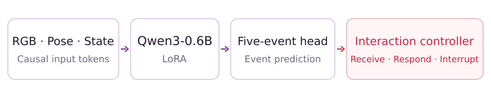
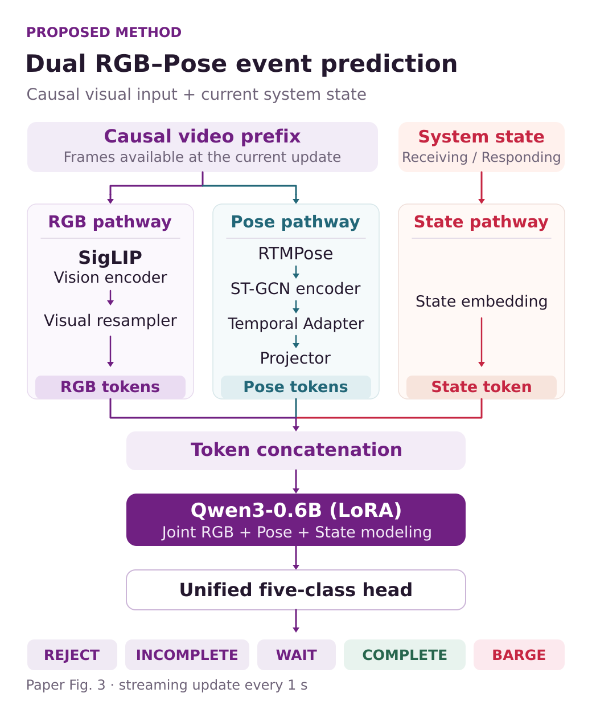
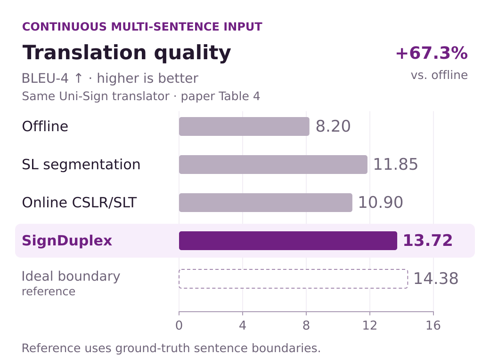
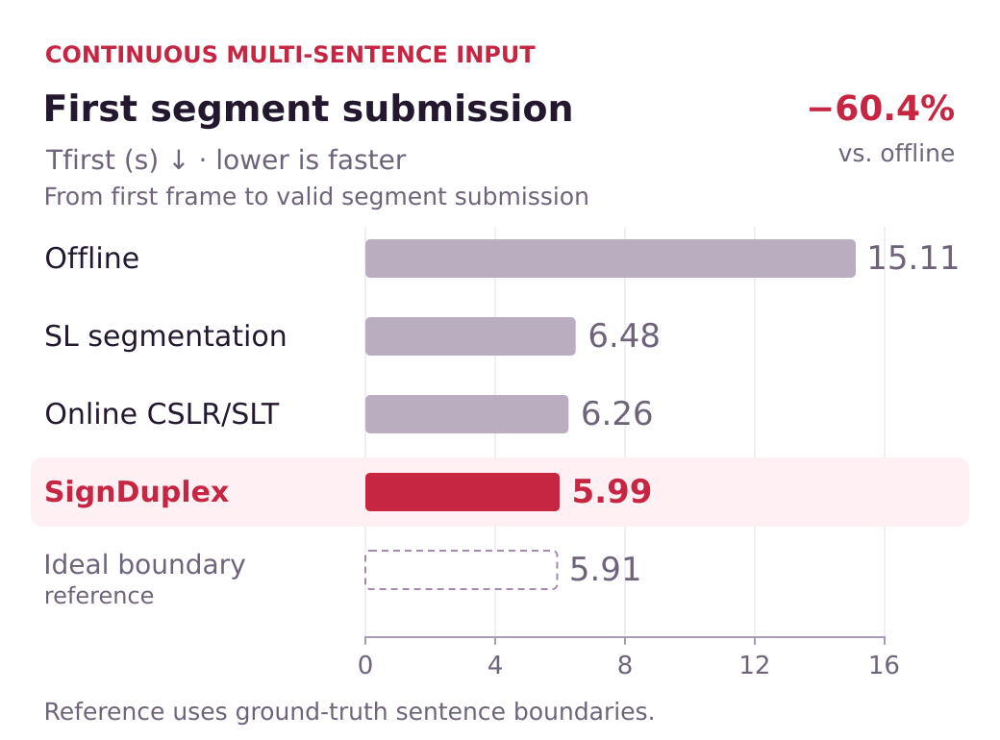

<p align="center">
  <a href="docs/assets/brand-banner.svg"></a>
</p>

<h3 align="center">A Full-Duplex Interaction Controller for<br>Real-Time Sign Language Communication</h3>

<p align="center">
  Yuxuan Wang<sup>1</sup> · Jiasheng Lu<sup>2,*</sup> · Ruiqing Yin<sup>2</sup> · Keyu Fan<sup>2</sup><br>
  <sup>1</sup>Tsinghua University, Beijing, China &nbsp; · &nbsp; <sup>2</sup>Huawei Technologies, China
</p>

<p align="center">
  <a href="https://x-agentic.github.io/SignDuplex/?v=playback-20261012#demo"><b>Demo ↗</b></a> &nbsp; / &nbsp;
  <a href="#method">Method</a> &nbsp; / &nbsp;
  <a href="#results">Results</a> &nbsp; / &nbsp;
  <a href="#signturn">SignTurn</a> &nbsp; / &nbsp;
  <a href="#citation">Citation</a>
</p>

**Knowing when to respond is part of understanding signing.** SignDuplex observes continuous visual input, recognizes five interaction events, and controls when a system keeps receiving, takes the turn, or stops its output. Its plug-and-play design separates interaction timing from downstream translation and response generation.

<table>
  <tr>
    <td align="center" width="50%"><b>94.99%</b><br>Overall event recognition accuracy</td>
    <td align="center" width="50%"><b>433.46 ms</b><br>Mean event-prediction latency</td>
  </tr>
  <tr>
    <td align="center"><b>+67.3%</b><br>Continuous-input BLEU-4</td>
    <td align="center"><b>−60.4%</b><br>Continuous-input first submission time</td>
  </tr>
</table>

<sub>Paper-reported results. Recognition is evaluated on SignTurn; prediction latency is measured on an NVIDIA RTX 4090. Translation gains compare SignDuplex with whole-video offline submission using the same Uni-Sign translator. First submission time ends when a valid video segment reaches the translator.</sub>

## Demo

**[Open the review samples ↗](https://x-agentic.github.io/SignDuplex/?v=playback-20261012#demo)**

Explore sample videos grouped into the five interaction-event categories: **REJECT**, **INCOMPLETE**, **WAIT**, **COMPLETE**, and **BARGE**. Each clip includes recorded model predictions prepared in advance and synchronized with video playback.

Use the playback controls to pause, seek, or replay a moment and inspect its predicted event.

## Method

<p align="center">
  <a href="docs/assets/method-summary.svg"></a>
</p>

**Appearance + motion + system state.** SigLIP and a visual resampler encode RGB appearance; RTMPose and ST-GCN provide temporal pose features through a Temporal Adapter and Projector. RGB, pose, and state tokens are combined in Qwen3-0.6B with LoRA and a unified five-class prediction head.

**Continuous perception, every second.** Each prediction uses the video and pose observed since the latest state transition. Accumulation restarts at a transition, and visual perception continues in both **RECEIVING** and **RESPONDING**.

<details>
<summary><b>View the detailed model architecture</b></summary>

<p align="center">
  <a href="docs/assets/method-overview.svg"></a>
</p>

[Open the full-size vector diagram](docs/assets/method-overview.svg).

</details>

| Event | Meaning | State-conditioned action |
| :--- | :--- | :--- |
| **REJECT** | Non-signing movements or brief backchannels that require no response | In RECEIVING, keep receiving |
| **INCOMPLETE** | A valid signed utterance is still in progress | In RECEIVING, keep receiving |
| **WAIT** | Brief deceleration, a posture hold, or a pause within an unfinished utterance | In RECEIVING, keep receiving |
| **COMPLETE** | The user has finished the current utterance and will not continue within this turn | In RECEIVING, submit the segment and switch to RESPONDING |
| **BARGE** | The user begins a new valid utterance during system output | In RESPONDING, stop output and switch to RECEIVING |

In RESPONDING, every non-BARGE event keeps the system responding.

## Results

**One translator, different submission strategies.** The downstream study uses the same Uni-Sign model for every strategy and evaluates original How2Sign sentences and continuous videos formed by concatenating multiple sentences.

Values are **single sentence / continuous multi-sentence input**.

| Submission strategy | BLEU-4 ↑ | First submission (s) ↓ |
| :--- | ---: | ---: |
| Offline Translation | 14.50 / 8.20 | 5.80 / 15.11 |
| SL Segmentation | 13.70 / 11.85 | 6.12 / 6.48 |
| Online CSLR/SLT | 12.80 / 10.90 | 5.98 / 6.26 |
| **SignDuplex** | **14.15 / 13.72** | **5.86 / 5.99** |
| Original (Reference) | 14.50 / 14.38 | 5.80 / 5.91 |

Original (Reference) uses ground-truth sentence boundaries. First submission time runs from the first video frame to the first valid segment submitted to the translation model; subsequent translation and speech generation are outside this metric. The segmentation and online baselines are adapted to How2Sign as described in Section 4.3.

<details>
<summary><b>View the translation quality and latency charts</b></summary>

<p align="center">
  <a href="docs/assets/results-quality.svg"></a>
</p>
<p align="center">
  <a href="docs/assets/results-latency.svg"></a>
</p>

Click a chart to open its full-size vector version.

</details>

<details>
<summary><b>Event recognition and modality ablation · Tables 1 and 3</b></summary>

| Method | REJECT | INCOMPLETE | WAIT | COMPLETE | BARGE | Mean E2E (ms) ↓ |
| :--- | ---: | ---: | ---: | ---: | ---: | ---: |
| SignDuplex | 96.88% | 93.52% | 93.06% | 97.53% | 96.00% | 433.46 |

| Visual input | REJECT | INCOMPLETE | WAIT | COMPLETE | BARGE |
| :--- | ---: | ---: | ---: | ---: | ---: |
| RGB-only | 93.44% | 89.04% | 89.86% | 91.10% | 88.67% |
| Pose-only | 92.34% | 92.16% | 87.92% | 94.79% | 93.33% |
| **RGB+Pose** | **96.88%** | **93.52%** | **93.06%** | **97.53%** | **96.00%** |

Class accuracies are weighted by their test sample counts to obtain **94.99% overall accuracy**. Mean E2E latency covers video input through completion of event prediction on an NVIDIA RTX 4090.

</details>

## SignTurn

**263,890 interaction-event samples · 57.6 hours · five events**

SignTurn draws on MoLo, O5S5, LING BING, and How2Sign. Training samples are built through a visual–semantic pipeline that combines dialogue annotations, hand-motion candidates, semantic verification, and training-only augmentation. The independent test set consists of recorded face-to-face conversations with manually annotated events.

<details>
<summary><b>Dataset composition · Table 2</b></summary>

| Event | Training samples | Test samples | Duration (h) |
| :--- | ---: | ---: | ---: |
| REJECT | 46,820 | 640 | 9.8 |
| INCOMPLETE | 116,540 | 1,250 | 25.6 |
| WAIT | 41,760 | 720 | 9.6 |
| COMPLETE | 48,930 | 730 | 10.7 |
| BARGE | 6,350 | 150 | 1.9 |
| **Total** | **260,400** | **3,490** | **57.6** |

</details>

<sub>Dataset statistics from Table 2; construction and test annotation are described in Section 3.4.</sub>

**Data and model release: forthcoming.**

## Citation

```bibtex
@misc{wang2026signduplex,
  title  = {SignDuplex: A Full-Duplex Interaction Controller for
            Real-Time Sign Language Communication},
  author = {Wang, Yuxuan and Lu, Jiasheng and Yin, Ruiqing and Fan, Keyu},
  year   = {2026},
  note   = {Manuscript},
  url    = {https://github.com/X-Agentic/SignDuplex}
}
```
