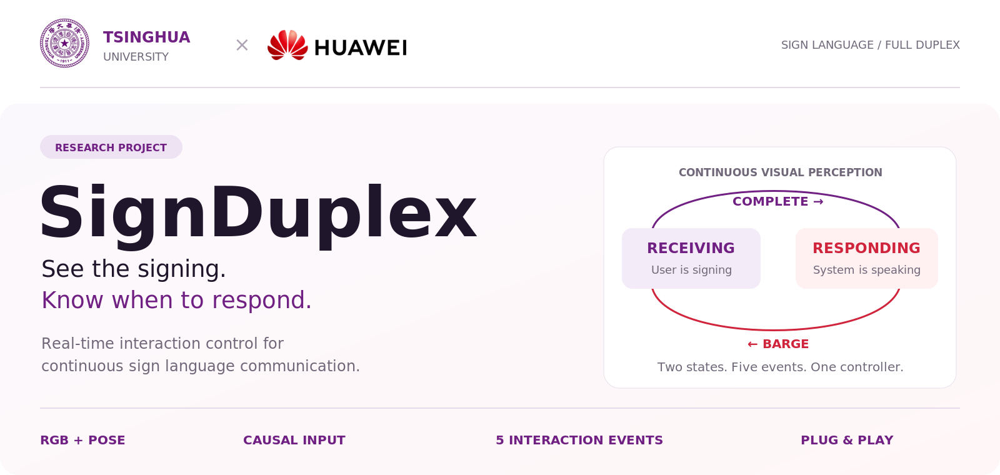
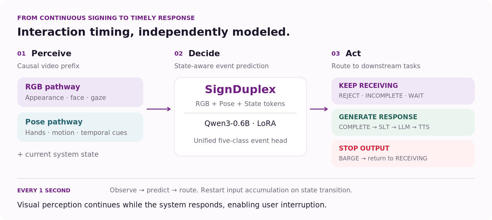
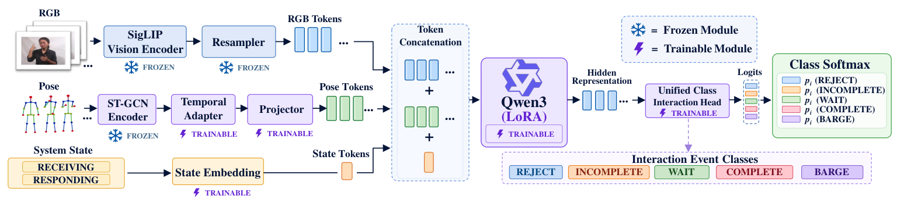
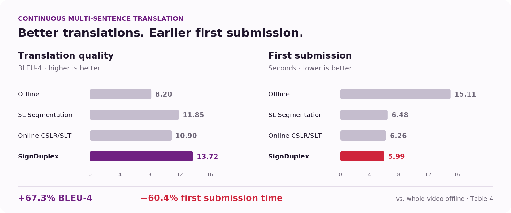

<p align="center">
  
</p>

<h3 align="center">A Full-Duplex Interaction Controller for<br>Real-Time Sign Language Communication</h3>

<p align="center">
  Yuxuan Wang<sup>1</sup> · Jiasheng Lu<sup>2,*</sup> · Ruiqing Yin<sup>2</sup> · Keyu Fan<sup>2</sup>
  <br>
  <sup>1</sup>Tsinghua University &nbsp;&nbsp; <sup>2</sup>Huawei Technologies
</p>

<p align="center">
  <a href="docs/paper/SignDuplex.pdf"><b>Read the Paper ↗</b></a> &nbsp; / &nbsp;
  <a href="#how-it-works">Method</a> &nbsp; / &nbsp;
  <a href="#results">Results</a> &nbsp; / &nbsp;
  <a href="#signturn-dataset">SignTurn</a> &nbsp; / &nbsp;
  <a href="#getting-started">Get Started</a>
</p>

---

**Good interaction depends on knowing when to respond.** SignDuplex is a plug-and-play controller that observes continuous signing, recognizes interaction events, and decides when a system should keep receiving input, generate a response, or stop its current output. It models **interaction timing** independently of downstream translation and response generation.

<table>
  <tr>
    <td align="center" width="25%"><h3>94.99%</h3>Event recognition accuracy</td>
    <td align="center" width="25%"><h3>433.46 ms</h3>Mean end-to-end prediction</td>
    <td align="center" width="25%"><h3>+67.3%</h3>Continuous-input BLEU-4</td>
    <td align="center" width="25%"><h3>−60.4%</h3>First submission time</td>
  </tr>
</table>

<sub>Reported in the accompanying paper. Recognition is evaluated on SignTurn; mean prediction latency is reported on an NVIDIA RTX 4090. Translation gains compare continuous multi-sentence input with whole-video offline submission using the same Uni-Sign translator. First submission time measures delivery of a video segment to the translator.</sub>

> **Release status:** This homepage presents the final paper. The currently released code contains the earlier **V1.8 model and V3.7.0 demo**; the paper's unified five-class Qwen3 implementation, SignTurn data, and model weights are pending release. See [Getting started](#getting-started) for the available implementation.

## How it works

<p align="center">
  
</p>

**Two complementary visual pathways.** RGB captures appearance, facial expression, and gaze; pose captures temporal motion. Their tokens are combined with a system-state token and passed to Qwen3-0.6B with LoRA and a unified interaction-event head.

**Continuous perception in both states.** The controller updates every second using only the observed prefix since the latest state transition. Visual perception continues while the system responds, so a new signed utterance can interrupt ongoing output.

| Event | What it means | Controller behavior |
| :--- | :--- | :--- |
| **REJECT** | Non-signing movement or a brief backchannel that needs no response | Keep receiving |
| **INCOMPLETE** | A valid signed utterance is still in progress | Keep receiving |
| **WAIT** | A brief pause or posture hold within an unfinished utterance | Keep receiving |
| **COMPLETE** | The user has finished the current utterance | Switch to responding; submit the segment |
| **BARGE** | The user starts a new valid utterance during system output | Stop output; switch to receiving |

In `RESPONDING`, non-BARGE events keep the system responding. In `RECEIVING`, `COMPLETE` initiates the downstream response. These are the **paper's** event definitions; the [legacy implementation](docs/architecture.md) uses a different routed prediction contract.

<details>
<summary><b>View the model architecture from the paper</b></summary>

<p align="center">
  
</p>

The SigLIP encoder, visual resampler, and ST-GCN encoder remain frozen. Training updates the Temporal Adapter, Projector, State Embedding, Qwen3 LoRA, and classification head. See Section 3 of the [paper](docs/paper/SignDuplex.pdf) for the complete formulation.

</details>

## Results

<p align="center">
  
</p>

All strategies below use the **same Uni-Sign translation model**. Only the segment submission strategy changes. Results are transcribed from Table 4 of the [paper](docs/paper/SignDuplex.pdf).

| Submission strategy | Single sentence<br>BLEU-4 ↑ | Continuous input<br>BLEU-4 ↑ | Single sentence<br>First submission (s) ↓ | Continuous input<br>First submission (s) ↓ |
| :--- | ---: | ---: | ---: | ---: |
| Offline translation | 14.50 | 8.20 | 5.80 | 15.11 |
| SL Segmentation | 13.70 | 11.85 | 6.12 | 6.48 |
| Online CSLR/SLT | 12.80 | 10.90 | 5.98 | 6.26 |
| **SignDuplex** | **14.15** | **13.72** | **5.86** | **5.99** |
| Original (Reference) | 14.50 | 14.38 | 5.80 | 5.91 |

<sub>Original (Reference) uses ground-truth sentence boundaries as an ideal-boundary reference. First submission time is measured from the first video frame to submission of the first valid segment; it does not include the subsequent translation or speech generation time. The segmentation and online baselines are adapted to How2Sign as described in Section 4.3.</sub>

<details>
<summary><b>Interaction recognition and modality ablation</b></summary>

Per-class recognition accuracies reported in Tables 1 and 3:

| Visual input | REJECT | INCOMPLETE | WAIT | COMPLETE | BARGE |
| :--- | ---: | ---: | ---: | ---: | ---: |
| RGB only | 93.44% | 89.04% | 89.86% | 91.10% | 88.67% |
| Pose only | 92.34% | 92.16% | 87.92% | 94.79% | 93.33% |
| **RGB + Pose** | **96.88%** | **93.52%** | **93.06%** | **97.53%** | **96.00%** |

The paper reports **94.99% overall accuracy**, weighted by the number of test samples in each event class, and **433.46 ms** mean end-to-end event-prediction latency.

</details>

## SignTurn dataset

**263,890 interaction-event samples · 57.6 hours · five event classes**

SignTurn combines ASL dialogue corpora—MoLo, O5S5, and LING BING—with sentence-level How2Sign data. The paper describes a visual–semantic construction pipeline for training data and separately recorded, manually annotated conversations for the test set.

| Event | Training samples | Test samples | Duration (h) |
| :--- | ---: | ---: | ---: |
| REJECT | 46,820 | 640 | 9.8 |
| INCOMPLETE | 116,540 | 1,250 | 25.6 |
| WAIT | 41,760 | 720 | 9.6 |
| COMPLETE | 48,930 | 730 | 10.7 |
| BARGE | 6,350 | 150 | 1.9 |
| **Total** | **260,400** | **3,490** | **57.6** |

Dataset statistics follow Table 2. **The SignTurn download is pending release.** Source-corpus access remains subject to each provider's terms.

## Getting started

The available implementation is the **V1.8 model with the V3.7.0 Gradio demo**. Its state-conditioned, factorized prediction heads differ from the final paper's unified five-class model. Use the [implementation guide](docs/legacy-implementation.md) for training, evaluation, data construction, and runtime behavior.

```bash
git clone https://github.com/X-Agentic/SignDuplex.git
cd SignDuplex
python -m venv .venv
. .venv/bin/activate
pip install -r requirements.txt
```

Use Python 3.10 and a CUDA-capable PyTorch environment. The demo additionally requires local **MiniCPM-o-4.5**, **Uni-Sign**, and the **V1.8 checkpoint**. The checkpoint download is pending release; see [weight placement instructions](checkpoints/README.md). Configure external model paths through [configs/env.example](configs/env.example).

<details>
<summary><b>Launch the legacy demo with local dependencies</b></summary>

Place the checkpoint at `checkpoints/signduplex_v1_8.pt`, then run:

```bash
python scripts/demo.py \
  --minicpm-dir /path/to/MiniCPM-o-4_5 \
  --unisign-dir /path/to/Uni-Sign
```

The released demo includes visual state tracking, interruption handling, reference subtitles, and simulated speech playback. For full commands, see the [implementation guide](docs/legacy-implementation.md).

</details>

<details>
<summary><b>Repository map</b></summary>

```text
signduplex/   Legacy V1.8 training and model implementation
demo/         V3.7.0 Gradio demo and interaction controller
scripts/      Training, evaluation, demo, and data entry points
configs/      Environment and local model path examples
docs/         Paper, figures, and implementation documentation
checkpoints/  Checkpoint placement instructions
```

</details>

## Citation

```bibtex
@misc{wang2026signduplex,
  title  = {SignDuplex: A Full-Duplex Interaction Controller for
            Real-Time Sign Language Communication},
  author = {Wang, Yuxuan and Lu, Jiasheng and Yin, Ruiqing and Fan, Keyu},
  year   = {2026},
  note   = {Manuscript},
  url    = {https://github.com/X-Agentic/SignDuplex}
}
```

## Acknowledgements

SignDuplex builds on MiniCPM-o, Uni-Sign, SigLIP, RTMPose, ST-GCN, and Qwen3, and draws on the sign language resources cited in the paper. Please follow the respective model licenses and dataset terms.

<p align="center">
  <sub><b>Tsinghua University × Huawei Technologies</b><br>Continuous perception. Timely response. Natural interaction.</sub>
</p>
